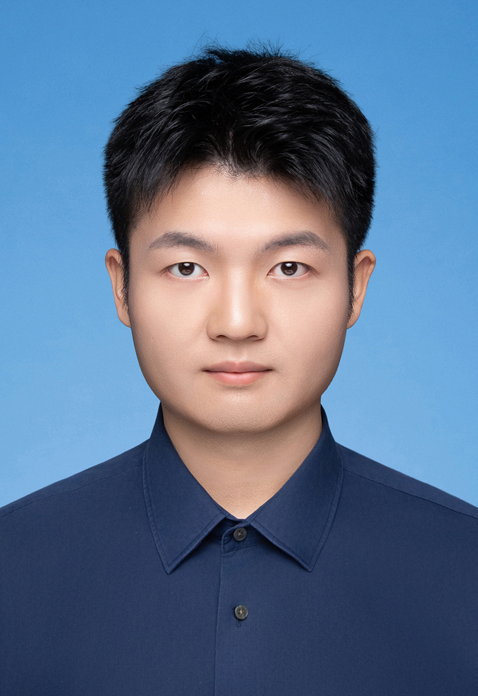
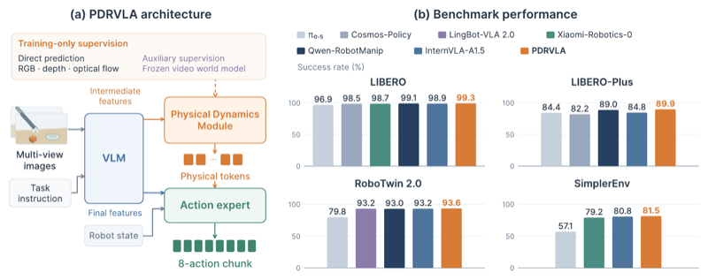
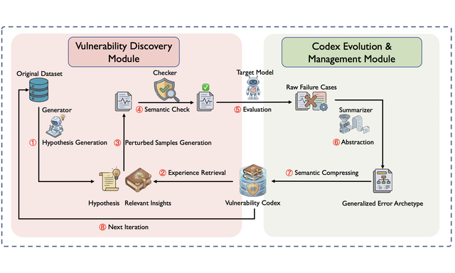
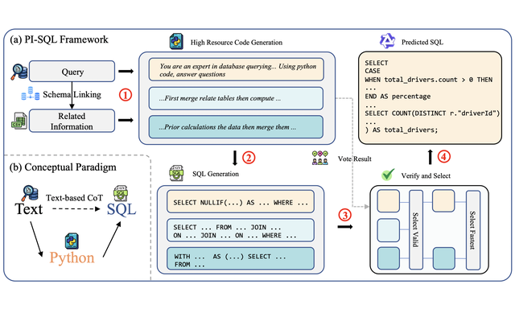
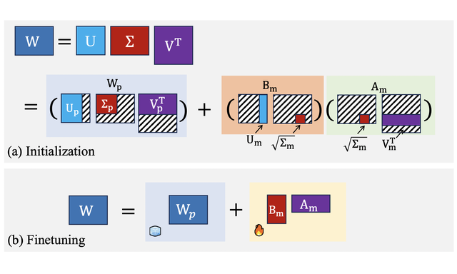
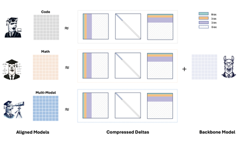
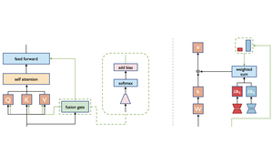
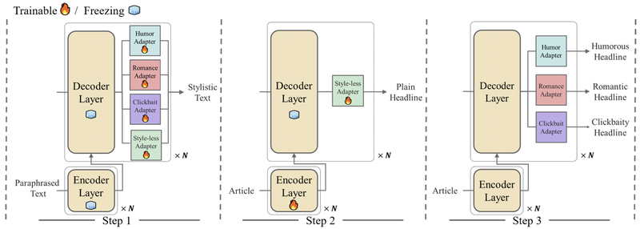

  

    

      
    

    

      <h1 class="hero-name">Hanqing Wang</h1>
      
Final-Year Ph.D. Candidate at Shanghai University of Finance and Economics (SUFE)

      
I am a final-year Ph.D. candidate at SUFE advised by Assoc. Prof. <a href="https://yunc.me">Yun Chen</a>. Previously, I was an algorithm intern at <b>JD Technology</b> working on VLA and embodied AI, and a research intern at <b>THUNLP &amp; Qiyuan Lab</b> mentored by <a href="https://scholar.google.com/citations?user=5vm5yAMAAAAJ&hl=en">Shuo Wang</a>. My work has appeared at NeurIPS, ACL, EMNLP, and NAACL, and I received the <b>SUFE Academic Star</b> (5 recipients annually) and the <b>National Ph.D. Scholarship</b>.

      

        <a href="mailto:whq@163.sufe.edu.cn" title="Email"><i class="fas fa-envelope"></i></a>
        <a href="https://scholar.google.com/citations?hl=en&user=1sFj7RcAAAAJ" title="Google Scholar"><i class="ai ai-google-scholar"></i></a>
        <a href="https://github.com/Eurus-W" title="GitHub"><i class="fab fa-github"></i></a>
        <a href="/files/Hanqing_Wang_CV.pdf" title="CV"><i class="ai ai-cv"></i></a>
      

    

  

  

    <i class="fas fa-bullseye"></i>
    <strong>On the 2026–2027 job market:</strong> open to <strong>Postdoc</strong> and <strong>Research Scientist</strong> positions · Expected graduation: June 2027
  

  
Research Interests

  
My research focuses on <strong>Vision-Language-Action (VLA) models</strong>, <strong>efficient LLM adaptation</strong>, and <strong>LLM agents</strong>, driven by a unifying question: <em>how can foundation models efficiently acquire, compose, and transfer capabilities across tasks, modalities, and physical environments?</em> Along this thread, I have developed parameter-efficient adaptation and compression methods (StyleBART, LoRA-Flow, Delta-CoMe, MiLoRA), training-free cross-modal reasoning transfer from text LLMs to MLLMs (XPD), and physical dynamics representations for low-latency robotic manipulation (PDRVLA). In parallel, I study self-evolving and stateful LLM agents — from automated latent-vulnerability discovery and cross-language code transfer (SAGE, Pi-SQL) to stateful execution harnesses for long-horizon tasks (Perdura).

    
News

    

      <ul class="news-list">
        <li>Oct 2026<i class="news-icon fas fa-file-alt"></i>Released <b>PDRVLA</b> on arXiv — selected as <b>Hugging Face Daily Paper #2</b> and <b>Monthly Paper #4</b>!</li>
        <li>Oct 2026<i class="news-icon fas fa-gavel"></i>Served as <b>Area Chair</b> for ACL Rolling Review (ARR, Oct 2026 cycle).</li>
        <li>Jul 2026<i class="news-icon fas fa-briefcase"></i>Joined <b>JD Technology</b> as an Algorithm Intern working on VLA &amp; Embodied AI.</li>
        <li>Apr 2026<i class="news-icon fas fa-file-alt"></i><b>SAGE</b> accepted to Findings of ACL 2026!</li>
        <li>Dec 2025<i class="news-icon fas fa-star"></i>Selected as <b>SUFE Academic Star</b> (5 recipients university-wide annually).</li>
        <li>Nov 2025<i class="news-icon fas fa-file-alt"></i><b>Pi-SQL</b> accepted to Findings of EMNLP 2025!</li>
        <li>Sep 2025<i class="news-icon fas fa-medal"></i>Awarded <b>National Scholarship for Doctoral Students</b>.</li>
        <li>Mar 2025<i class="news-icon fas fa-file-alt"></i>Two papers (<b>MiLoRA</b> at Main, <b>MALoRA</b> at Findings) accepted to NAACL 2025!</li>
        <li>Jan 2025<i class="news-icon fas fa-briefcase"></i>Completed research internship at THUNLP &amp; Qiyuan Lab.</li>
        <li>Sep 2024<i class="news-icon fas fa-file-alt"></i><b>Delta-CoMe</b> accepted to NeurIPS 2024!</li>
        <li>Sep 2024<i class="news-icon fas fa-award"></i>Awarded First-Class Academic Scholarship at SUFE.</li>
        <li>May 2024<i class="news-icon fas fa-file-alt"></i><b>LoRA-Flow</b> accepted to ACL 2024 Main!</li>
        <li>Oct 2023<i class="news-icon fas fa-file-alt"></i><b>StyleBART</b> accepted to Findings of EMNLP 2023!</li>
        <li>Sep 2023<i class="news-icon fas fa-briefcase"></i>Started research internship at THUNLP &amp; Qiyuan Lab.</li>
        <li>Jun 2022<i class="news-icon fas fa-graduation-cap"></i>Received Bachelor's degree in Computer Science (Honors &amp; Outstanding Graduate) from SUFE.</li>
      </ul>
    

  

  

    
Selected Publications

    

      

        

          
          arXiv 2026
        

        

          
<a href="/publication/2026_pdrvla">PDRVLA: A Vision-Language-Action Model with Physical Dynamics Representations</a>

          Hanqing Wang*, Zhaotian Cai*, Ruichuan An*, Bohan Zeng*, Tao Zhang*, Yilin Chen*, Xu Jiang, Kaiquan Chen, Chongyang Wu, Haoran Li, Fan Yang, Mingan Lin, Wentao Zhang, Zenan Zhou, Youzheng Wu, Xiaodong He
          

            <a href="https://arxiv.org/abs/2610.37381"><i class="far fa-file-pdf"></i> Paper</a>
            ·
            <a href="https://huggingface.co/papers/2610.37381"><i class="fas fa-fire"></i> HF Paper</a>
            ·
            <i class="fas fa-award"></i>HF Daily Paper #2 · Monthly Paper #4
          

          
<strong>TL;DR:</strong> Extracts compact physical tokens from intermediate VLM features via direct future RGB/depth/optical-flow prediction and frozen video world-model supervision — conditioning VLA action generation without online video latency (99.3% LIBERO, 89.9% LIBERO-Plus, 93.6% RoboTwin 2.0, 81.5% SimplerEnv).

        

      

      

        

          
          ACL 2026
        

        

          
<a href="/publication/2026_sql_vulnerabilities">Beyond Static Rules: Automated Discovery of Latent Vulnerabilities in Text-to-SQL</a>

          Hanqing Wang*, Yongdong Chi*, Jian Yang, Lei Yang, Jiehui Zhao, Yun Chen, Guanhua Chen
          

            <a href="https://aclanthology.org/2026.findings-acl.842/"><i class="far fa-file-pdf"></i> Paper</a>
            ·
            <a href="https://github.com/sustech-nlp/SAGE"><i class="fab fa-github"></i> Code</a>
            ·
            ACL 2026 Findings · CCF-A
          

          
<strong>TL;DR:</strong> SAGE (Systematic Automated Guided Exploration) automates discovery of latent failure patterns in LLM Text-to-SQL — generating vulnerability hypotheses with a continuously evolving Vulnerability Codex of perturbations.

        

      

      

        

          
          EMNLP 2025
        

        

          
<a href="/publication/2025_pi_sql">Pi-SQL: Enhancing Text-to-SQL with Fine-Grained Guidance from Pivot Programming Languages</a>

          Yongdong Chi*, Hanqing Wang*, Yun Chen, Yan Yang, Jian Yang, Zonghan Yang, Xiao Yan, Guanhua Chen
          

            <a href="https://aclanthology.org/2025.findings-emnlp.1369/"><i class="far fa-file-pdf"></i> Paper</a>
            ·
            <a href="https://github.com/sustech-nlp/Pi-SQL"><i class="fab fa-github"></i> Code</a>
            ·
            EMNLP 2025 Findings · CCF-B
          

          
<strong>TL;DR:</strong> Uses Python as a pivot intermediate representation to give Text-to-SQL fine-grained structural guidance — leveraging LLMs' stronger Python understanding to bootstrap better SQL generation.

        

      

      

        

          
          NAACL 2025
        

        

          
<a href="/publication/2025_milora">MiLoRA: Harnessing Minor Singular Components for Parameter-Efficient LLM Finetuning</a>

          Hanqing Wang, Yixia Li, Shuo Wang, Guanhua Chen, Yun Chen
          

            <a href="https://aclanthology.org/2025.naacl-long.248/"><i class="far fa-file-pdf"></i> Paper</a>
            ·
            <a href="https://github.com/sufenlp/MiLoRA"><i class="fab fa-github"></i> Code</a>
            ·
            NAACL 2025 Main · CCF-B · 150+ citations
          

          
<strong>TL;DR:</strong> Initializes LoRA adapters using the <em>minor</em> singular components of pre-trained weights — reducing interference with the base model's existing knowledge while still enabling effective task adaptation.

        

      

      

        

          
          NeurIPS 2024
        

        

          
<a href="/publication/2024_delta_come">Delta-CoMe: Training-Free Delta-Compression with Mixed-Precision for Large Language Models</a>

          Bowen Ping*, Shuo Wang*, Hanqing Wang, Xu Han, Yuzhuang Xu, Yukun Yan, Yun Chen, Baobao Chang, Zhiyuan Liu, Maosong Sun
          

            <a href="https://openreview.net/pdf?id=cr5EQRJlRn"><i class="far fa-file-pdf"></i> Paper</a>
            ·
            <a href="https://github.com/thunlp/Delta-CoMe"><i class="fab fa-github"></i> Code</a>
            ·
            NeurIPS 2024 · CCF-A
          

          
<strong>TL;DR:</strong> Compresses the <em>delta</em> (fine-tuned minus base weights) of an aligned LLM with mixed-precision quantization — recovering near-full performance with a fraction of storage and zero retraining.

        

      

      

        

          
          ACL 2024
        

        

          
<a href="/publication/2024_lora_flow">LoRA-Flow: Dynamic LoRA Fusion for Large Language Models in Generative Tasks</a>

          Hanqing Wang*, Bowen Ping*, Shuo Wang, Xu Han, Yun Chen, Zhiyuan Liu, Maosong Sun
          

            <a href="https://aclanthology.org/2024.acl-long.695/"><i class="far fa-file-pdf"></i> Paper</a>
            ·
            <a href="https://github.com/thunlp/LoRAFlow"><i class="fab fa-github"></i> Code</a>
            ·
            ACL 2024 Main · CCF-A
          

          
<strong>TL;DR:</strong> Replaces fixed LoRA fusion weights with a per-token dynamic gate — letting multiple task-specific LoRA adapters be combined adaptively during generation rather than averaged with a static recipe.

        

      

      

        

          
          EMNLP 2023
        

        

          
<a href="/publication/2023_style_bart">StyleBART: Decorate Pretrained Model with Style Adapters for Unsupervised Stylistic Headline Generation</a>

          Hanqing Wang*, Yajing Luo*, Boya Xiong, Guanhua Chen, Yun Chen
          

            <a href="https://aclanthology.org/2023.findings-emnlp.697/"><i class="far fa-file-pdf"></i> Paper</a>
            ·
            <a href="https://github.com/sufenlp/StyleBART"><i class="fab fa-github"></i> Code</a>
            ·
            EMNLP 2023 Findings · CCF-B
          

          
<strong>TL;DR:</strong> Adds lightweight style adapters on top of frozen BART to generate stylistic news headlines without paired data — decoupling content faithfulness from style transfer.

        

      

    

  

