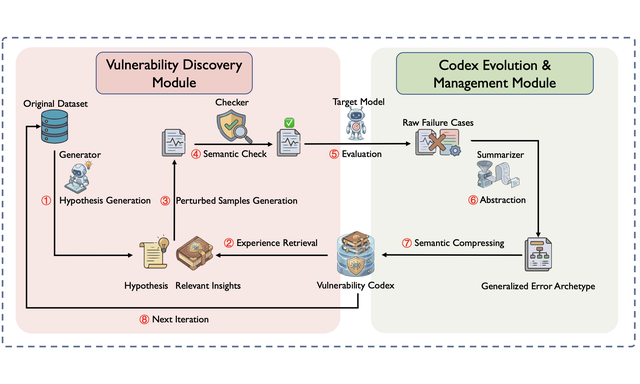
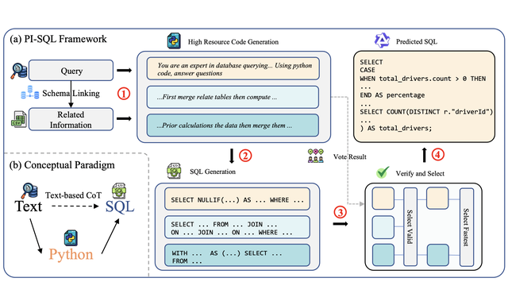
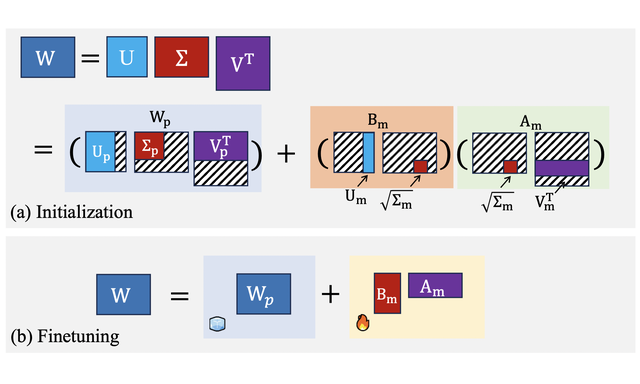
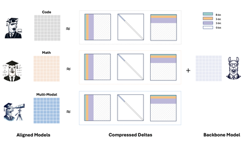
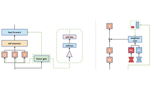
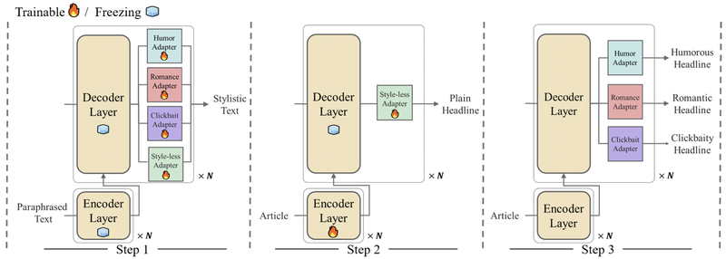

  

    

      
    

    

      <h1 class="hero-name">王涵青 · Hanqing Wang</h1>
      
上海财经大学 博士四年级

      
我的研究围绕一个问题：<b>如何高效地把能力注入并跨大语言模型迁移？</b>目前的工作集中在参数高效微调（PEFT）、模型压缩、跨任务 / 跨模态的知识迁移——也越来越关注同样的视角如何延伸到 Agent 技能设计上。

      
我是上海财经大学四年级博士生，导师为 <a href="http://yunc.me">陈芸 教授</a>；此前曾在清华 THUNLP &amp; QY Lab 跟随 <a href="https://scholar.google.com/citations?user=5vm5yAMAAAAJ&hl=en">王硕</a> 老师做研究实习。论文发表于 ACL、EMNLP、NAACL、NeurIPS。近期入选 <b>上财学术之星</b>（全校每年 5 名博士生）。

      

        <a href="mailto:whq@163.sufe.edu.cn" title="邮箱"><i class="fas fa-envelope"></i></a>
        <a href="https://scholar.google.com/citations?hl=en&user=1sFj7RcAAAAJ" title="Google Scholar"><i class="ai ai-google-scholar"></i></a>
        <a href="https://github.com/Eurus-W" title="GitHub"><i class="fab fa-github"></i></a>
        <a href="/" title="English"><i class="fas fa-language"></i></a>
      

    

  

  

    <i class="fas fa-bullseye"></i>
    <strong>正在寻找工业界研究岗</strong> · 预计 2027 年 7 月毕业
  

  
代表荣誉

  

    

      <i class="fas fa-star"></i>
      <h4>学术之星</h4>
      
上财全校每年 5 名博士生 · 2025 年 12 月

    

    

      <i class="fas fa-medal"></i>
      <h4>国家奖学金</h4>
      
全国约 3% 博士生获奖 · 教育部 · 2025 年 9 月

    

  

  
代表论文

  

    

      

        
        ACL 2026
      

      

        
<a href="/publication/2026_sql_vulnerabilities">Beyond Static Rules: Automated Discovery of Latent Vulnerabilities in Text-to-SQL</a> SAGE

        Hanqing Wang*, Yongdong Chi*, Jian Yang, Lei Yang, Jiehui Zhao, Yun Chen, Guanhua Chen
        

          ACL 2026 Findings · CCF-A
        

        
<strong>TL;DR：</strong> SAGE（Systematic Automated Guided Exploration）自动化挖掘 LLM Text-to-SQL 中的潜在失败模式——突破静态规则检测的局限，通过生成漏洞假设 + 持续演化的漏洞图谱设计针对性扰动。

      

    

    

      

        
        EMNLP 2025
      

      

        
<a href="/publication/2025_pi_sql">Pi-SQL: Enhancing Text-to-SQL with Fine-Grained Guidance from Pivot Programming Languages</a>

        Yongdong Chi*, Hanqing Wang*, Yun Chen, Yan Yang, Jian Yang, Zonghan Yang, Xiao Yan, Guanhua Chen
        

          <a href="https://aclanthology.org/2025.findings-emnlp.1369/"><i class="far fa-file-pdf"></i> Paper</a>
          ·
          <a href="https://github.com/sustech-nlp/Pi-SQL"><i class="fab fa-github"></i> Code</a>
          ·
          EMNLP 2025 Findings · CCF-B
        

        
<strong>TL;DR：</strong> 用 Python 作为枢纽中间表示给 Text-to-SQL 提供细粒度结构化引导——借助 LLM 对 Python 更强的理解为 SQL 生成提供 step-by-step 引导，执行准确率较最强基线最高提升 3.20。

      

    

    

      

        
        NAACL 2025
      

      

        
<a href="/publication/2025_milora">MiLoRA: Harnessing Minor Singular Components for Parameter-Efficient LLM Finetuning</a>

        Hanqing Wang, Yixia Li, Shuo Wang, Guanhua Chen, Yun Chen
        

          <a href="https://aclanthology.org/2025.naacl-long.248/"><i class="far fa-file-pdf"></i> Paper</a>
          ·
          <a href="https://github.com/sufenlp/MiLoRA"><i class="fab fa-github"></i> Code</a>
          ·
          NAACL 2025 Main · CCF-B
        

        
<strong>TL;DR：</strong> 用预训练权重的<em>次要奇异分量</em>初始化 LoRA 适配器——在保留基础模型既有知识的同时仍能高效完成任务适配。

      

    

    

      

        
        NeurIPS 2024
      

      

        
<a href="/publication/2024_delta_come">Delta-CoMe: Training-Free Delta-Compression with Mixed-Precision for Large Language Models</a>

        Bowen Ping, Shuo Wang, Hanqing Wang, Xu Han, Yuzhuang Xu, Yukun Yan, Yun Chen, Baobao Chang, Zhiyuan Liu, Maosong Sun
        

          <a href="https://openreview.net/pdf?id=cr5EQRJlRn"><i class="far fa-file-pdf"></i> Paper</a>
          ·
          <a href="https://github.com/thunlp/Delta-CoMe"><i class="fab fa-github"></i> Code</a>
          ·
          NeurIPS 2024 · CCF-A
        

        
<strong>TL;DR：</strong> 对对齐后 LLM 的<em>增量权重</em>（fine-tuned 减 base）做混合精度量化——零再训练即可近似恢复全精度性能，存储仅占一小部分。

      

    

    

      

        
        ACL 2024
      

      

        
<a href="/publication/2024_lora_flow">LoRA-Flow: Dynamic LoRA Fusion for Large Language Models in Generative Tasks</a>

        Hanqing Wang*, Bowen Ping*, Shuo Wang, Xu Han, Yun Chen, Zhiyuan Liu, Maosong Sun
        

          <a href="https://aclanthology.org/2024.acl-long.695/"><i class="far fa-file-pdf"></i> Paper</a>
          ·
          <a href="https://github.com/thunlp/LoRAFlow"><i class="fab fa-github"></i> Code</a>
          ·
          ACL 2024 Main · CCF-A
        

        
<strong>TL;DR：</strong> 用 per-token 动态门控替代固定的 LoRA 融合权重——让多个任务 LoRA 在生成时按 token 自适应融合，而不是静态加权平均。

      

    

    

      

        
        EMNLP 2023
      

      

        
<a href="/publication/2023_style_bart">StyleBART: Decorate Pretrained Model with Style Adapters for Unsupervised Stylistic Headline Generation</a>

        Hanqing Wang*, Yajing Luo*, Boya Xiong, Guanhua Chen, Yun Chen
        

          <a href="https://aclanthology.org/2023.findings-emnlp.697/"><i class="far fa-file-pdf"></i> Paper</a>
          ·
          EMNLP 2023 Findings · CCF-B
        

        
<strong>TL;DR：</strong> 在冻结的 BART 上叠加轻量级风格适配器——无配对数据生成风格化新闻标题，将内容保真与风格迁移解耦。

      

    

  

